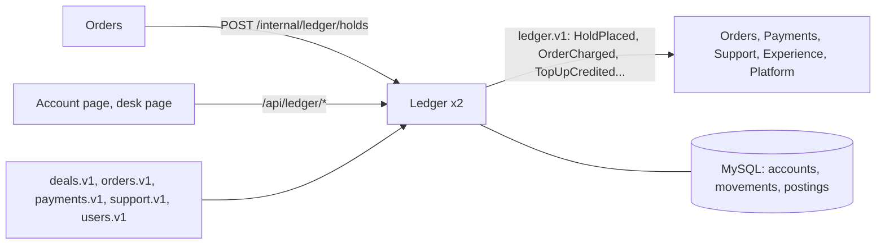

# Ledger

The bank inside Campus Group-Buy, line A. It decides whether a student's money is available, and records where every cent goes. Every top-up, hold, charge, release, refund, cash-out and payout is a movement whose postings add up to zero. Orders asks us, in one direct call, whether a student's money is available; everything else arrives and leaves as Kafka events.

## Where things are

| You want | Read |
|---|---|
| Deploy, verify, operate, recover it | [docs/HANDOVER.md](docs/HANDOVER.md) |
| How it works and why | [docs/ARCHITECTURE.md](docs/ARCHITECTURE.md), [docs/decisions/](docs/decisions/) |
| Every table and key, and what each operation writes | [docs/SCHEMA.md](docs/SCHEMA.md) |
| What the Ledger does in every case | [docs/EDGE-CASES.md](docs/EDGE-CASES.md) |
| What we own, what we need from each team, what they need from us | [docs/NEIGHBOURS.md](docs/NEIGHBOURS.md) |
| Time and load targets, with results | [docs/Constraints.md](docs/Constraints.md) |
| Who owns what; each item's steps | [OWNERS.md](OWNERS.md), [work-items/](work-items/) |
| Proof from live runs | [docs/evidence/](docs/evidence/) |
| Show the proof of concept | [docs/POC-DEMO.md](docs/POC-DEMO.md) |
| Rules for changing the code | [agents/AGENTS.md](agents/AGENTS.md) (read by Claude Code and OpenCode too) |

## How the money works

The Students' Union plays the bank: it takes cash at the desk, holds everyone's money, owes restaurants their payable and earns commission. Money enters only through a desk top-up (on the dev kit, `./sim money-in` sends a batch of TopUpRecorded events).

| Account (`owner_type`, `purpose`) | `owner_id` | Means |
|---|---|---|
| STUDENT AVAILABLE | studentId | Money the student can spend, set aside or cash out |
| STUDENT HELD | studentId | Money **set aside** for open orders and reserved cash-outs |
| RESTAURANT PAYABLE | restaurantId | What the Union owes the restaurant: up at settlement, down at a refund or payout |
| UNION CASH | the zero UUID | The other side of desk money: a top-up posts −, a cash-out or payout posts +. Its negative is the cash the Union holds |
| UNION COMMISSION | the zero UUID | The Union's share of each charged order |

The Union's two accounts exist from the first start; the others open on first use. Only student balances are kept as a running number (`balance_cents`); Union and restaurant balances are the sum of their postings (decision 0005).

A €10 top-up:

| Account | Amount |
|---|---|
| Student available | +€10 |
| Union cash | −€10 |
| **Sum** | **0** |

### Each operation

| Operation | Comes in | Money | Goes out |
|---|---|---|---|
| Top-up | TopUpRecorded (Payments) | Union CASH → student AVAILABLE | TopUpCredited |
| Hold | `POST /internal/ledger/holds` (Orders) | AVAILABLE → HELD | HoldPlaced, or HoldRejected with nothing moved |
| Release | OrderWithdrawn, OrderAbandoned (Orders); DealFailed, DealCancelled (Deals) | HELD → AVAILABLE | HoldReleased |
| Settlement | DealConfirmed (Deals) | HELD → restaurant PAYABLE and Union COMMISSION; the rest back to AVAILABLE | OrderCharged per order, SettlementIssue per problem, one DealSettled |
| Refund | RefundApproved (Support) | Restaurant PAYABLE and Union COMMISSION → AVAILABLE | RefundPosted or RefundRefused |
| Cash-out | WithdrawalRequested, then WithdrawalCompleted or WithdrawalFailed (Payments) | AVAILABLE → HELD, then HELD → Union CASH, or back to AVAILABLE | WithdrawalDebited or WithdrawalRefused, then WithdrawalPaidOut or WithdrawalReturned |
| Payout | PayoutConfirmed (Payments) | Restaurant PAYABLE → Union CASH | PayoutDebited |

**The hold** checks in order, and the first that fails decides:
1. Valid body? Otherwise 422 or 413, nothing saved.
2. Seen this orderId? Return the stored answer.
3. Order closed, then deal closed? ORDER_CLOSED, DEAL_CLOSED.
4. Enough available? INSUFFICIENT_FUNDS, with `availableCents`.

A refusal is recorded like a placed hold, so a retry gets the same answer. No posting can take a student balance below zero.

**Settlement, worked.** The deal confirms at €5 with 10% commission (rounded half up). The student had €7 set aside.

| Account | Amount |
|---|---|
| Student held | −€7.00 |
| Restaurant payable | +€4.50 |
| Union commission | +€0.50 |
| Student available | +€2.00 |
| **Sum** | **0** |

- The €2 is **returned**, not a refund: the difference between what was set aside and what the order cost.
- A listed order that can't be charged (no hold, already released or charged, another deal or student, below the price) gets a SettlementIssue and keeps its hold for staff (LED-10).
- An open hold for the deal that isn't on the list is released (NOT_ON_LIST).
- `deal_settlement` is claimed first, so a deal settles once, even through a crash.

**Reading a balance.** `GET /api/ledger/me` returns the student's available and set-aside amounts from committed rows, so it never shows half a movement; a student with no accounts yet reads zeros. `GET /api/ledger/me/entries` is the statement: each change to available, in the student's words.

**Two instances, one truth.** `ledger-1` and `ledger-2` share one MySQL database; either answers any call or event, and the database decides races. Locks go in one order (decision 0004): business rows, then student accounts by ascending id, then the outbox counter.

## Words

| Word | Means | Avoid |
|---|---|---|
| Account | Where one owner's money of one kind sits (table above) | wallet; balance (for the place) |
| Movement | One change of money: two or more postings that add up to zero, done once per business key | transaction (the database's word), transfer |
| Posting | One side of a movement: a signed amount on one account | line, leg |
| Business key | The ID that makes an effect happen once: orderId for a hold or charge, topUpId for a top-up, dealId for a settlement | idempotency key (the HTTP header) |
| Set aside | A student's money held for undecided orders or a reserved cash-out; the words students see | hold, held, reserved (anything a student reads) |
| Hold | Money moved from available to set aside for one order | reservation, authorisation |
| Hold answer | The Ledger's one decision for an order: placed, insufficient funds, order closed or deal closed. The first is final | |
| Closure | The record that an order or deal can take no more money, so a later hold is refused | |
| Release | A hold's money back to available because the order or its deal won't go ahead | refund (after a charge), cancellation |
| Settlement | Turning a confirmed deal's holds into charges, exactly once, in one transaction | |
| Charge | One order paying the tier price: commission to the Union, the rest to the restaurant's payable | |
| Returned | What is left of a hold after its charge, back to available | change, refund |
| Settlement issue | A listed order that can't be charged; reported to staff, never charged | |
| Refund | Money back after a charge, approved by Support, never more than the charge | release (before a charge) |
| Cash-out | A student taking money out at the desk: reserved first, then paid out or returned | withdrawal (anything a student reads; the events use it) |
| Payout | The Union paying a restaurant from its payable, once per payoutId | |
| Commission | The deal's rate times the price, rounded half up to the cent | |
| Statement entry | One line on a student's statement: a change to their available money | posting (anything a student reads) |
| Neighbour | Another team's service that sends us events or reads ours ([NEIGHBOURS](docs/NEIGHBOURS.md)) | |
| Contracts | The organisers' library (1.3.0) fixing every event's and API's shape. We never change it | |
| Envelope | The wrapper on every event: `eventId` (the inbox skips a repeat), `key` and `sequence` (order per key), `causationId` | |
| Dead letter | An event sent to `ledger.dlt`: at once if it breaks the contract, otherwise after about 2.5 min of retries (15 min while MySQL is unreachable). Platform replays it once fixed | |

## Start

See [Handover](HANDOVER.md)

