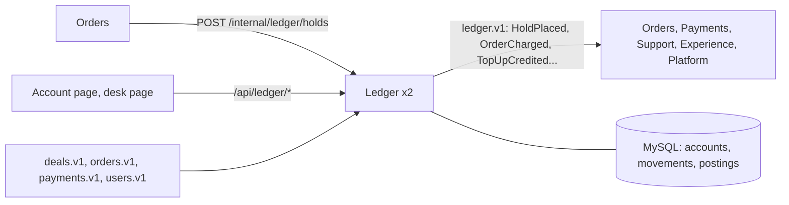

# Ledger

The bank inside Campus Group-Buy, line A. Every cent a student tops up, sets aside for a lunch, pays, gets back or takes out is a movement between two accounts, and the two sides always add up to zero. Orders asks us, in one direct call, whether a student's money is available; everything else arrives and leaves as Kafka events.

Kotlin 2.1 and Spring Boot 3.4 on JDK 21, MySQL with Flyway, Kafka with an outbox. Two instances, 512 MB each.



## Where things are

| You want | Read |
|---|---|
| Deploy, verify, operate, recover it | [docs/HANDOVER.md](docs/HANDOVER.md) |
| How it works and why | [docs/ARCHITECTURE.md](docs/ARCHITECTURE.md), [docs/decisions/](docs/decisions/README.md) |
| Every table and column | [docs/schema.md](docs/SCHEMA.md) |
| The words we use | [GLOSSARY.md](GLOSSARY.md) |
| What we own, what we need from each team, what they need from us | [docs/NEIGHBOURS.md](docs/NEIGHBOURS.md) |
| What's done and what's left | [PHASES.md](PHASES.md) |
| Who owns what; each item's steps | [OWNERS.md](OWNERS.md), [work-items/](work-items/README.md) |
| Proof from live runs | [docs/evidence/](docs/evidence/) |
| Show the proof of concept | [docs/POC-DEMO.md](docs/POC-DEMO.md) |
| Rules for changing the code | [agents/AGENTS.md](agents/AGENTS.md) (read by Claude Code and OpenCode too) |

## Start

1. `cp .env.example .env` (sets `SERVICE_NAME=ledger`; Git ignores `.env`).
2. Put your Forgejo token in `~/.gradle/gradle.properties`, never in this repository:
   ```properties
   forgejoUser=your-forgejo-username
   forgejoToken=the-token
   ```
3. Start the dev kit (its README). For our real Ledger behind the gateway, set `LEDGER_URL=http://ledger:8080` and `FAKE_EXCLUDE=ledger` in `dev-kit/.env`, then `docker compose --profile lite up -d`.
4. Use JDK 21: Gradle 8.12 fails on 24. On macOS, `export JAVA_HOME=$(/usr/libexec/java_home -v 21)`.

Podman instead of Docker: [SETUP.md](SETUP.md).

## Commands

| Command | Does | Needs |
|---|---|---|
| `./gradlew test` | Unit tests | JDK 21 |
| `./gradlew contractTest` | Every event we publish against the contracts library (CI runs it) | JDK 21 |
| `./gradlew containerTest` | Real MySQL and Kafka, two instances (CI does **not** run it) | Docker |
| `./check` | Tests, image, two instances healthy within 512 MB. Run before every PR | Docker, dev kit |
| `./gradlew bootJar && docker compose up -d --build` | Two instances: `ledger-1` on 8081, `ledger-2` on 8082 | Dev kit |
| `scripts/run-local.sh [port]` | One instance from the IDE settings in `local.env` | Dev kit |
| `scripts/drills/check.sh`, `scripts/drills/holds.sh N` | Outage drills (LED-21): a before/after snapshot, and N hold calls: [docs/DRILLS.md](docs/DRILLS.md) | Dev kit, both instances |

Add `--rerun-tasks` to a Gradle test command to run the tests again instead of reusing the last results.

## The starter's plumbing

`src/.../platform/` comes from the organisers' starter: leave it as it is, except `PUBLIC_PATHS` in `Security.kt`.

| You need | Use | Where |
|---|---|---|
| Move money | `LedgerPostingService.post(reference, lines)`, the only way | `ledger/LedgerPostings.kt` |
| A balance for a decision or an event | `lockStudent` / `lockStudents` | `ledger/LedgerAccounts.kt` |
| Publish an event | `outbox.publish(event)` inside the money's transaction | `platform/Outbox.kt` |
| Consume an event once | `@KafkaListener(id = "...", idIsGroup = false)` and `inbox.once(...) { }`; add a branch to the topic's one listener | `platform/Events.kt` |
| An event that arrives too early | `parking.park(...)`, then `parking.release(...)` | `platform/Events.kt` |
| The time | The injected `Clock`, never `Instant.now()` | `platform/PlatformClock.kt` |
| The signed-in user | A `user: CurrentUser` parameter; `requireOwner`, `requireRole` | `platform/Security.kt` |
| An error a caller can act on | `throw Conflict(...)`, `NotFound(...)`, `Invalid(...)` | `platform/Problems.kt` |
| A table | The next free Flyway `V` number when you merge; never edit an applied one | `src/main/resources/db/migration` |
| Tests on real MySQL and Kafka | Extend `ContainersTest`; `TestTokens`, `TestClock` | `src/test/.../support/` |

## CI and images

Every push to `main`, every tag and every pull request runs the unit tests, then the contract tests as their own step, then builds and pushes `cs4297.skynet.ie/hackathon-2026/line-a-ledger:sha-<7 chars>` (and `:<tag>` for a tag). Promotion and the deploy gate use a tag: `checkpoint-1`, `checkpoint-2`, `checkpoint-3`, `release`. The gate has no Java, so it runs the image, never Gradle (HANDOVER §4).

## Two penalties (each ×0.75 on the project mark)

- A secret committed at any point in the history. Secrets go in `~/.gradle/gradle.properties` or a `*.local.env` file. The `DB_PASSWORD` in `local.env` and `service.env` is the dev kit's local value and does not count.
- A binary over 1 MB committed without Git LFS (`git lfs track "*.pdf"` and so on, before `git add`).

## When something goes wrong

The full table, keyed to the literal error text, is [HANDOVER §9](docs/HANDOVER.md#9-troubleshooting). The ones you hit while building:

| You see | Do |
|---|---|
| `./gradlew` fails at start-up and `java -version` says 24 | Set `JAVA_HOME` to JDK 21 (Start, step 4) |
| `Could not resolve ie.ul.cs4297.groupbuy:contracts:1.3.0` ... `401` | No packages token: see Start, step 2; it needs `read:package` |
| `Received status code 429` from Maven Central | Venue network: wait a minute and build again |
| `network hackathon declared as external, but could not be found` | Start the dev kit first: it creates the network |
| `Migration checksum mismatch` | Old schema in the dev kit's `ledger` database: drop and create it (dev kit only) |
| `./gradlew: Permission denied` | `git update-index --chmod=+x gradlew check scripts/*.sh`, then commit |
