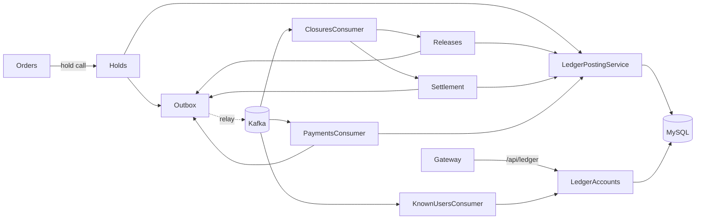

# Ledger architecture

The Ledger decides one thing: whether a student's money is available. Every movement of money is a set of postings that sum to zero. Structured by the module's seven steps; decisions in [decisions/](decisions/README.md), progress in [PHASES.md](../PHASES.md). Words: [GLOSSARY.md](../GLOSSARY.md). What we own, what we need from each team and what they need from us: [NEIGHBOURS.md](NEIGHBOURS.md).

## 1. Requirements

| Caller | Operation | Must |
|---|---|---|
| Orders | Hold call | Answer within 2 s; one answer per orderId on either instance |
| Payments | Top-ups, cash-outs, payouts | Apply each business ID once |
| Deals | Confirmed / failed / cancelled | Settle exactly once, even through a crash |
| Support | Refunds | Never exceed the charge; wait if early |
| Student, Union finance | `/me`, entries, desk balance | Show the committed balance |
| Platform | UserRegistered; metrics and events for its alerts | Open each student's accounts once; publish every event once |

**Invariants** (each one a test can break):
1. Every movement sums to zero.
2. No student balance is ever below zero.
3. One orderId gets one hold answer.
4. A hold for a closed order or deal is refused.
5. A hold ends once: released or charged.
6. A deal settles exactly once.
7. No order is refunded more than it was charged.
8. Each student's event balances chain in sequence order.

## 2. Estimates

| Load | Number |
|---|---|
| Hold calls at peak | 100/s for 20 s (LED-22) |
| Largest deal | 200 orders in the load test (PLT-14), about 1,400 rows in one transaction |
| Students funded in integration | 204 |
| Memory per instance | 512 MB limit, about 330 MB used |

The load is small. The risks are **contention** (hot rows, long locks) and **correctness under retries**, not throughput.

## 3. API and events

| Hold answer | HTTP | When |
|---|---|---|
| PLACED / INSUFFICIENT_FUNDS | 200 | Enough money, or not (with `availableCents`) |
| ORDER_CLOSED / DEAL_CLOSED | 200 | A closing event was already processed |
| VALIDATION_FAILED / PAYLOAD_TOO_LARGE | 422 / 413 | Bad input / over 64 KB |
| UNAVAILABLE | 503 | Database trouble: nothing saved, so a retry decides afresh |

A timeout after commit is safe: Orders retries the same orderId and gets the stored answer (`lecture06a.pdf` pp. 4–12). Page routes take the student ID from the token only (`lecture09b.pdf` pp. 4–11). If the sign-in key can't be fetched, they answer 503.

| Topic | One listener | Effect |
|---|---|---|
| payments.v1 | `PaymentsConsumer` | Credit top-ups; later cash-outs, payouts |
| orders.v1, deals.v1 | `ClosuresConsumer` | Close; release; settle; open payables |
| users.v1 | `KnownUsersConsumer` (starter, `example/`) | Open student accounts |
| support.v1 | `SupportConsumer` (planned, item 6) | Refunds; the rest of support.v1 is ignored |
| ledger.v1 | Outbox relay (starter) | Every Ledger event, balance after it; keyed by student, restaurant or deal ([NEIGHBOURS §4](NEIGHBOURS.md#4-event-keys)) |

## 4. Data

| Table | Key | Source of truth for |
|---|---|---|
| `ledger_account` | owner + purpose | Accounts; `balance_cents` kept for **students only** |
| `ledger_movement` | (type, reference id) | Whether an effect happened (top-up, hold, charge...) |
| `ledger_posting` | id | Every balance, recomputable |
| `hold_decision` | order_id | First hold answer; `state` OPEN → RELEASED or CHARGED |
| `order_closure`, `deal_closure` | order_id, deal_id | Refusing late holds |
| `order_charge`, `deal_settlement` | order_id, deal_id | What was charged; that a deal settled |
| `refund`, `withdrawal` (planned) | refund_id, withdrawal_id | Each refund's and cash-out's outcome (items 6, 8; [schema §7](schema.md#7-fit-with-the-contracts)) |
| starter inbox, outbox, parking | event id | Once-only consumption, publishing, early events |

## 5. Design

**A hold, step by step:**
1. Validate the body (422 / 413).
2. Insert `hold_decision` (PENDING). If the row exists, return the stored answer.
3. Read the closure rows FOR SHARE; refuse if closed.
4. Lock the student's accounts; refuse if short.
5. Post AVAILABLE → HELD, save PLACED / OPEN, and queue HoldPlaced in the outbox.

Everything commits together.

## 6. Deep dives

**Lock order** (decision 0004), the rule that prevents deadlocks:
1. Business rows: holds by order_id, then closure and claim rows.
2. Student accounts, all at once, ascending id.
3. The outbox counter, which `publish` locks.

Union and restaurant accounts have no running balance, so they're never locked (decision 0005, `tutorial-nosql.pdf` pp. 3–9: hot rows).

**Settlement** (decision 0007): one local transaction, not a saga, because every row is ours (`lecture12a-the-on-sale-1.pdf` pp. 6–11).
- The inbox catches a repeated envelope; `deal_settlement` catches a new envelope for the same deal.
- A crash rolls everything back, and redelivery settles once.
- Measured: 202 orders in 0.79 s during k6, so holds for those students still answer within 2 s ([evidence](evidence/led-22-holds-k6.md)).

**Chaining** (LED-20): every balance on an event is read under the student lock. The outbox numbers events per key in commit order: per-key FIFO, not total order (`lecture10c_2.pdf` pp. 3–9).

## 7. Failures

| Failure | Ledger's response |
|---|---|
| Orders times out after commit | Retry returns the stored answer |
| Same order on both instances | Primary key: the second waits, then reads the first |
| Database down | 503 within about 1 s; normal once it's back |
| Kafka down | Events wait in the outbox, then go out in order |
| Instance killed mid-settlement | Rollback; redelivery settles once |
| Duplicate event | Inbox (event id) and business key (topUpId, orderId, ...) |
| Refund before its charge | Parked, woken by the charge or release |
| Zero amount, unreadable message | Dead-letter topic; consumer moves on |
| Deadlock | Hold retries within 1 s; consumer redelivers |

**First failure worth testing:** kill an instance mid-settlement while holds arrive for the same students.

## Kept from the starter

`platform/` untouched. One package, `service/ledger`. JdbcTemplate, Flyway, `ContainersTest`. Time only from the injected `Clock`.
