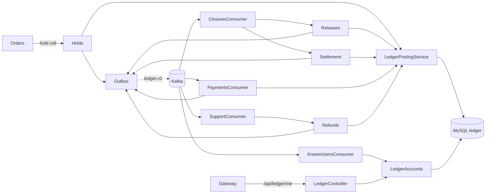

# Ledger handover

For the assessor at the deploy gate and anyone on call. Sections follow the template (reference, Appendix B). Every command is run as written; every expected output is from a real run on the dev kit (Sat 14 Nov 2026) unless marked **Not yet**. Item 4 (Shakeeba) owns this file; other items write their own sections.

## 1 About this service

The Ledger is the bank inside Campus Group-Buy. It decides one thing, whether a student's money is available, and records every movement of money between students, restaurants and the Union. Every movement is two or more postings that add up to zero, so any balance can be recomputed from its postings (§8).

| It does | Trigger | It publishes on ledger.v1 |
|---|---|---|
| Set money aside for an order (the hold) | `POST /internal/ledger/holds` from Orders, the system's one direct call | HoldPlaced or HoldRejected |
| Credit a desk top-up | TopUpRecorded (payments.v1) | TopUpCredited |
| Open accounts | UserRegistered (users.v1), RestaurantRegistered (deals.v1) | |
| Give set-aside money back | OrderWithdrawn, OrderAbandoned (orders.v1); DealFailed, DealCancelled (deals.v1) | HoldReleased |
| Settle a confirmed deal, once | DealConfirmed (deals.v1) | OrderCharged per order, SettlementIssue per problem, one DealSettled |
| Show a balance and statement | `GET /api/ledger/me`, `/me/entries` through the gateway | |
| Show any student's balance at the desk | `GET /api/ledger/students/{id}` through the gateway (Union finance) | |
| Give money back after a charge, never more than charged | RefundApproved (support.v1) | RefundPosted or RefundRefused |
| Cash-outs at the desk: reserve, then pay out or return | WithdrawalRequested, then WithdrawalCompleted or WithdrawalFailed (payments.v1) | WithdrawalDebited or WithdrawalRefused, then WithdrawalPaidOut or WithdrawalReturned |
| Pay a restaurant from its payable | PayoutConfirmed (payments.v1) | PayoutDebited |

Who depends on each of these: [NEIGHBOURS.md](NEIGHBOURS.md). How it is built and why: [ARCHITECTURE.md](ARCHITECTURE.md).



Two instances (`ledger-1`, `ledger-2`) share one database. Either can answer any call or event: the database decides, never the instance.

## 2 Prerequisites

Nothing beyond the reference machine: Git, Docker Engine with Docker Compose, the dev kit (cloned, images pulled), and the login to `cs4297.skynet.ie` it already has. No Java, no Gradle. The image is `linux/amd64`.

## 3 Configuration

Every setting is in `service.env`, already set to the dev kit's values. Change nothing to run against the fake line.

| Setting | Default (dev kit) | Integration |
|---|---|---|
| `SERVICE_NAME` | `ledger` | same |
| `KAFKA_BOOTSTRAP_SERVERS` | `kafka:29092` | set by the organisers |
| `DB_URL` | `jdbc:mysql://mysql:3306/ledger` | set by the organisers |
| `DB_USER`, `DB_PASSWORD` | `ledger`, the dev kit's local value (not a secret) | set by the organisers |
| `CLOCK_URL` | `http://clock:8080/internal/clock` | set by the organisers |
| `JWT_PUBLIC_KEY_URL` | `http://signin:8080/.well-known/jwks.json` | set by the organisers |
| `MAIL_HOST`, `MAIL_PORT` | `mailpit`, `1025` (unused by the Ledger) | |
| `IMAGE` (shell, not the file) | `ledger:local` | `cs4297.skynet.ie/hackathon-2026/line-a-ledger:<tag>` |

`.env` holds only `SERVICE_NAME=ledger` (from `.env.example`). Each instance is capped at 512 MB in `compose.yml`.

**Fake line or integration.** On the fake line, the dev kit's `.env` must send the Ledger's traffic to us and switch off the fake Ledger: `LEDGER_URL=http://ledger:8080`, `FAKE_EXCLUDE=ledger` (§4 step 2). In integration the organisers promote our image; there is nothing to set.

## 4 Deploy

About 2 minutes: 1 for the dev kit, under 1 for the Ledger (both instances were UP 14 s after start on a laptop).

1. Clone the repository, from the folder that holds the dev kit:
   ```bash
   git clone https://cs4297.skynet.ie/hackathon-2026/line-a-ledger.git && cp line-a-ledger/.env.example line-a-ledger/.env
   ```
2. Point the dev kit at the real Ledger, add our dashboard, and start it with the full profile:
   ```bash
   cd dev-kit
   sed -i 's|^LEDGER_URL=.*|LEDGER_URL=http://ledger:8080|; s|^FAKE_EXCLUDE=.*|FAKE_EXCLUDE=ledger|' .env
   cp ../line-a-ledger/grafana/ledger.json grafana/dashboards/
   mkdir -p grafana/provisioning/alerting && cp ../line-a-ledger/grafana/alerting/ledger.yml grafana/provisioning/alerting/
   docker compose --profile full up -d
   ```
   If the dev kit was already running, also `docker compose up -d --force-recreate grafana`: Grafana reads the alert file only at start-up.
   Ready when http://localhost:8080 shows a page (about a minute).
3. Start both Ledger instances from the image CI built for the `release` tag:
   ```bash
   cd ../line-a-ledger
   IMAGE=cs4297.skynet.ie/hackathon-2026/line-a-ledger:release docker compose up -d --no-build
   ```
4. Ready when both answer UP:
   ```bash
   curl -s localhost:8081/actuator/health; echo; curl -s localhost:8082/actuator/health; echo
   ```
   Expected, twice: `{"status":"UP","groups":["liveness","readiness"]}`

A fresh database is built by Flyway on first start; a restart keeps every balance.

## 5 Verify

Run from the dev kit folder. Each step's expected output is what we saw; IDs will differ.
New IDs come from `/proc/sys/kernel/random/uuid` (any Linux); on macOS use `uuidgen | tr A-Z a-z` instead.

1. **The gateway reaches our Ledger.**
   ```bash
   curl -s -H "Authorization: Bearer $(./token student011)" localhost:8080/api/ledger/hello; echo
   ```
   Expected: `"service":"ledger"` and `"instance":"ledger-1"` or `"ledger-2"`.
2. **Fund the students** (a real Ledger starts everyone at 0):
   ```bash
   ./sim money-in --students 204
   ```
   Expected: lines of `payments.v1  TopUpRecorded`, then `Deal: …`.
3. **The top-up landed.**
   ```bash
   curl -s -H "Authorization: Bearer $(./token student011)" localhost:8080/api/ledger/me; echo
   ```
   Expected: `{"studentId":"…","availableCents":…,"heldCents":…}`, with `availableCents` 2000 higher than before step 2 (each money-in credits every student 2000 once; we saw 5 → 2005).
4. **One hold, asked three times on two instances, moves money once.**
   ```bash
   S=$(curl -s -H "Authorization: Bearer $(./token student011)" localhost:8080/api/ledger/me | grep -o '"studentId":"[^"]*"' | cut -d'"' -f4)
   B="{\"orderId\":\"$(cat /proc/sys/kernel/random/uuid)\",\"studentId\":\"$S\",\"dealId\":\"$(cat /proc/sys/kernel/random/uuid)\",\"cutoffAt\":\"2026-11-15T12:00:00Z\",\"amountCents\":600}"
   for p in 8081 8082 8081; do curl -s -X POST localhost:$p/internal/ledger/holds -H 'Content-Type: application/json' -d "$B"; echo; done
   ```
   Expected: `"result":"PLACED"` three times. `/me` (step 3) now shows 600 less available and 600 held, not 1800.
5. **Short of money, and bad input.**
   ```bash
   curl -s -X POST localhost:8082/internal/ledger/holds -H 'Content-Type: application/json' -d "{\"orderId\":\"$(cat /proc/sys/kernel/random/uuid)\",\"studentId\":\"$S\",\"dealId\":\"$(cat /proc/sys/kernel/random/uuid)\",\"cutoffAt\":\"2026-11-15T12:00:00Z\",\"amountCents\":999999}"; echo
   curl -s -X POST localhost:8081/internal/ledger/holds -H 'Content-Type: application/json' -d '{"orderId":"nope","amountCents":0}'; echo
   ```
   Expected: `"result":"INSUFFICIENT_FUNDS","availableCents":…` (what the student has left), then a 422 with `"code":"VALIDATION_FAILED"` listing all five fields.
6. **The golden path: 12 students join, the deal tips, the Ledger settles.**
   ```bash
   D=$(./sim deal-opens --cutoff 2 | grep -o 'Deal: [0-9a-f-]*' | cut -d' ' -f2)
   for i in $(seq 31 42); do curl -s -X POST -H "Authorization: Bearer $(./token student0$i)" -H "Idempotency-Key: $(cat /proc/sys/kernel/random/uuid)" localhost:8080/api/orders/deals/$D/orders; echo; done
   ./clock advance 3m
   ```
   Expected: 12 lines with `"status":"CONFIRMED","heldCents":600`. About 10 s after the clock moves, the settlement query in §8 for `$D` shows 12 charged, 6000, 600: each order paid 500, 50 to the Union, 100 back.
7. **A hold after the deal closed is refused.** With `$D` from step 6:
   ```bash
   curl -s -X POST localhost:8081/internal/ledger/holds -H 'Content-Type: application/json' -d "{\"orderId\":\"$(cat /proc/sys/kernel/random/uuid)\",\"studentId\":\"$S\",\"dealId\":\"$D\",\"cutoffAt\":\"2026-11-15T12:00:00Z\",\"amountCents\":600}"; echo
   ```
   Expected: `"result":"DEAL_CLOSED"`.
8. **The books balance.** Run "Is the whole Ledger balanced?" in §8. Expected: every row 0.
9. **Always last:** `./clock reset`.
10. **Contract tests**: the green CI run for the `release` tag. **Not yet:** link added when `release` is tagged.

## 6 Your properties

Checked with repeats, disorder and a stopped instance. Tests that need Java are shown from their committed output ([evidence/](evidence/)), made with `./gradlew containerTest --rerun-tasks`.

| Marked property | Show it live | Recorded proof | Status |
|---|---|---|---|
| Every movement sums to zero; no student balance negative | §8 "Is the whole Ledger balanced?" after §5: every row 0 | `ZeroSumPropertyTest`: 200 random runs of top-ups, holds, releases, settlements, refunds, cash-outs and payouts; after every step all postings sum to 0 and no student is below 0 ([evidence](evidence/led-20-zero-sum.md)). Why it holds: `post()` refuses a movement whose sides don't sum to 0, and a student's balance only changes by `balance_cents + ? >= 0` | Done |
| A deal settles exactly once, through a crash | `./sim deal-confirmed --repeat` publishes DealConfirmed twice; §8 "One deal's settlement" shows one row | `SettlementTest`: a crash halfway charges nothing, the retry settles once; DealConfirmed twice settles once | Done |
| No order refunded more than it was charged | Refund more than is left of the charge: RefundRefused `EXCEEDS_CHARGE` (`refund` row, no REFUND movement) | `RefundsTest`: over the charge refused; part refunds of 5 then 445 on 450 reverse 1 then 44 commission; a repeat posts once | Done; an early refund is parked, then posted on its charge or refused NEVER_CHARGED |
| A hold after its order or deal closed is refused | §5 step 7: DEAL_CLOSED | `HoldsTest`: ORDER_CLOSED and DEAL_CLOSED, before and racing the closure | Done |

Also checked by the test agents: every hold within 2 s, also during a 202-order settlement ([LED-22 k6](evidence/led-22-holds-k6.md): max 666 ms); each event's balance-after chains with the one before (every balance on an event is read under the student's lock).

## 7 Dashboard tour

Grafana at http://localhost:3000, folder "Dev kit", dashboard "Ledger" (`grafana/ledger.json`, copied in §4 step 2); set "Scrape job" to `services`. The same measures are on each instance (`curl -s localhost:8081/actuator/prometheus | grep '^ledger_'`):

| Measure | What normal looks like |
|---|---|
| `ledger_holds_seconds{result}`: hold rate, latency, answer | Mostly PLACED; every answer well under 2 s (k6 max 666 ms at 100/s) |
| `ledger_settlement_seconds` | One per confirmed deal; about 0.1 s for 12 orders, 0.79 s for 202 (k6) |
| `ledger_settlement_issues_total` | 0. Anything else is a listed order we couldn't charge: §8 |
| `ledger_dead_letters`: messages on `ledger.dlt` | 0 new during a run (§9, K4) |
| `ledger_refunds_parked`, `ledger_refunds_parked_oldest_seconds` | A few for a moment while a deal settles; the oldest well under 6 h. Over 6 h the alert "Ledger: refund parked over 6 h" fires (Grafana, folder Ledger): §8 "Is money stuck?" |
| `ledger_daily_check_problems`, `ledger_daily_check_last_run_seconds` | 0 problems; last run at 02:00 Irish time. A problem is named in the log line `Daily check` |

## 8 Runbooks

**Database shell** (the dev kit's MySQL, `ledger` database):
```bash
docker exec -it devkit-mysql-1 sh -c 'mysql -uroot -p"$MYSQL_ROOT_PASSWORD" ledger'
```

### Where did a student's money go? (LED-24)

Balance, kept and recomputed (the two columns must match each other and `/me`):

```sql
SELECT a.purpose, a.balance_cents AS kept, COALESCE(SUM(p.amount_cents), 0) AS from_postings
FROM ledger_account a LEFT JOIN ledger_posting p ON p.account_id = a.id
WHERE a.owner_type = 'STUDENT' AND a.owner_id = '<studentId>'
GROUP BY a.id, a.purpose, a.balance_cents ORDER BY a.purpose;
```

Every movement, oldest first (`reference_id` is the topUpId, orderId, refundId...):

```sql
SELECT m.posted_at, m.reference_type, m.reference_id, a.purpose, p.amount_cents, p.description
FROM ledger_posting p JOIN ledger_account a ON a.id = p.account_id JOIN ledger_movement m ON m.id = p.movement_id
WHERE a.owner_type = 'STUDENT' AND a.owner_id = '<studentId>'
ORDER BY m.posted_at, p.id;
```

### Is the whole Ledger balanced?

All three rows must read 0.

```sql
SELECT 'all postings', COALESCE(SUM(amount_cents), 0) FROM ledger_posting
UNION ALL SELECT 'movements not summing to 0', COUNT(*) FROM (
  SELECT movement_id FROM ledger_posting GROUP BY movement_id HAVING SUM(amount_cents) <> 0) x
UNION ALL SELECT 'student balances not matching postings', COUNT(*) FROM (
  SELECT a.id FROM ledger_account a LEFT JOIN ledger_posting p ON p.account_id = a.id
  WHERE a.owner_type = 'STUDENT' GROUP BY a.id, a.balance_cents
  HAVING a.balance_cents <> COALESCE(SUM(p.amount_cents), 0)) y;
```

Union and restaurant balances are the sum of their postings (decision 0005). Their `balance_cents` stays 0: never read it.

```sql
SELECT COALESCE(SUM(p.amount_cents), 0) FROM ledger_posting p JOIN ledger_account a ON a.id = p.account_id
WHERE a.owner_type = 'RESTAURANT' AND a.owner_id = '<restaurantId>' AND a.purpose = 'PAYABLE';
```

### One deal's settlement (LED-24)

DealSettled's totals against the charges (must match):

```sql
SELECT s.charged_count, s.total_charged_cents, s.total_commission_cents,
       COUNT(c.order_id), COALESCE(SUM(c.price_cents), 0), COALESCE(SUM(c.commission_cents), 0)
FROM deal_settlement s LEFT JOIN order_charge c ON c.deal_id = s.deal_id
WHERE s.deal_id = '<dealId>' GROUP BY s.deal_id, s.charged_count, s.total_charged_cents, s.total_commission_cents;
```

Where the money went (the rows sum to 0):

```sql
SELECT a.owner_type, a.purpose, SUM(p.amount_cents)
FROM order_charge c
JOIN ledger_movement m ON m.reference_type = 'ORDER_CHARGE' AND m.reference_id = c.order_id
JOIN ledger_posting p ON p.movement_id = m.id JOIN ledger_account a ON a.id = p.account_id
WHERE c.deal_id = '<dealId>' GROUP BY a.owner_type, a.purpose;
```

Example: 11 orders at 500 with 10% commission and 600 set aside gives RESTAURANT 4950, STUDENT AVAILABLE 1100, STUDENT HELD −6600, UNION COMMISSION 550.

### Is money stuck?

Open holds on a closed deal: money still set aside that nothing will charge. Normally no rows. A CONFIRMED row is an order listed but not charged (a SettlementIssue): its money comes back when its order closes. A FAILED or CANCELLED row is a bug. Platform's stuck-hold alert (PLT-11) watches the same thing from our events.

```sql
SELECT h.deal_id, dc.reason, COUNT(*) AS open_holds, SUM(h.amount_cents) AS set_aside_cents, MIN(h.decided_at) AS oldest
FROM hold_decision h JOIN deal_closure dc ON dc.deal_id = h.deal_id
WHERE h.state = 'OPEN' GROUP BY h.deal_id, dc.reason ORDER BY oldest;
```

Parked refunds: each waits for its order's charge (`order:<id>`) or, with no money set aside, its deal's outcome (`deal:<id>`). One over 6 h means Deals or Orders never sent that outcome: ask them, don't post it by hand.

```sql
SELECT waits_for, event_id, parked_at FROM parked_event WHERE consumer = 'support-v1' ORDER BY parked_at;
```

Cash-outs reserved but never finished: each waits for Payments' WithdrawalCompleted or WithdrawalFailed. One left for hours means Payments never sent it: ask them, don't post it by hand.

```sql
SELECT withdrawal_id, student_id, amount_cents, decided_at FROM withdrawal WHERE state = 'RESERVED' ORDER BY decided_at;
```

### Failures (reference, Scenarios K)

| Failure | Symptom | Confirm | Fix |
|---|---|---|---|
| **K1** Kafka down | Holds still answer; events stop appearing on ledger.v1; top-ups and settlements wait | `SELECT COUNT(*) FROM outbox_event WHERE published_at IS NULL;` grows | Nothing: when Kafka returns, the outbox sends them in order and consumers catch up. Check the count falls to 0 |
| **K2** One instance dies | Calls to it fail for a moment | `docker compose ps` shows one instance down | Nothing: the gateway and Orders' retry use the other; Kafka moves its partitions; repeats are absorbed. Restart: `docker compose up -d` |
| **K2** Killed mid-settlement | That deal's settlement didn't finish | `deal_settlement` has no row for the deal | Nothing: the transaction rolled back; redelivery settles the whole deal once. Then check §8 "One deal's settlement" |
| **K3** Ledger down 10 min | New orders stay pending and are abandoned after 2 min; top-ups and settlement wait | Both health checks fail | `docker compose up -d`. Holds answer again; queued events are applied once each; abandoned orders are released |
| **K3** Database down | Holds, `/me`, the statement and the desk balance answer 503 `UNAVAILABLE` within about 1 s | `docker compose logs --tail 40 instance-1` shows connection errors | Restart MySQL. 503s stop within seconds; nothing was half-saved, so retries decide afresh |
| **K4** An event we can't process | It retried 5 times over about 2.5 min, then went to `ledger.dlt` | `docker exec devkit-kafka-1 kafka-get-offsets --bootstrap-server localhost:9092 --topic ledger.dlt` (any partition above 0) and the `Dead letter:` line in the log | Fix the cause; the platform team replays it, and anything parked behind it then applies |
| **K5** Rebuild | The Ledger is a source of truth, not a view: never dropped | §8 "Is the whole Ledger balanced?" | Balances recompute from postings (§8) |
| **K7** Clock | Settlement or releases seem late after `./clock advance` | `./clock` | Wait 5 s: services read the clock every 5 s. The Ledger never refuses for time |
| **K8** Popular deal | One deal's events all on one partition | `docker exec devkit-kafka-1 kafka-consumer-groups --bootstrap-server localhost:9092 --describe --group ledger` (LAG) | Expected: keeps each deal in order. A 200-order deal settles in one transaction: 0.5 to 1 s on a quiet machine, up to about 2.8 s on a busy one ([evidence](evidence/edge-cases-2026-11-15.md)) |

## 9 Troubleshooting

| You see | Do |
|---|---|
| `Migration checksum mismatch for migration version 3` | Old schema in the dev kit's `ledger` database: on a dev kit only, `docker exec devkit-mysql-1 sh -c 'mysql -uroot -p"$MYSQL_ROOT_PASSWORD" -e "DROP DATABASE ledger; CREATE DATABASE ledger;"'`, then `docker compose up -d --force-recreate` |
| `network hackathon declared as external, but could not be found` | Start the dev kit first (§4 step 2): it creates the network |
| `pull access denied` or `unauthorized` for `cs4297.skynet.ie/...` | `docker login cs4297.skynet.ie` |
| `/api/ledger/...` answers `502` with `NOTHING_ANSWERS` | Both instances are down, or the dev kit's `LEDGER_URL` is wrong: `docker compose ps`, then §4 step 2 |
| `/api/ledger/hello` doesn't say `"service":"ledger"` | The dev kit still uses the fake Ledger: §4 step 2, then `docker compose --profile full up -d --force-recreate gateway fakes` |
| `/me` answers 503 "Sign-in is briefly unavailable" | The sign-in key (`JWT_PUBLIC_KEY_URL`) is unreachable; it recovers once it's back |
| A hold answers `503` `UNAVAILABLE` | Database trouble (§8, K3). Nothing was saved; retry |
| `Could not resolve placeholder 'DB_URL'` (or another name) | A setting is missing from `service.env` (§3) |
| `UnknownHostException: kafka` or `Communications link failure` | `service.env` uses `localhost`: use `kafka:29092` and `mysql:3306` |
| Container exits with code 137 | It hit 512 MB: `docker compose logs --tail 40 instance-1`; run one instance while debugging |

## 10 Known limitations

- A `DealConfirmed` outside the contract (negative price, commission outside 0–10000) can't come from Deals; if one arrives anyway it moves nothing, is retried for 2.5 min, then goes to `ledger.dlt`.
- One `orderId` listed twice with different students in a `DealConfirmed`: the second is dropped without a SettlementIssue.
- A listed order that can't be charged keeps its money set aside until its order closes (§8 "Is money stuck?"). The alert is Platform's (PLT-11).
- All three were left out on purpose: [item 9, Out of scope](../work-items/item9_robustness.md#out-of-scope).
- MySQL frozen rather than stopped: a hold waits until it returns, not 503 in 1 s. MySQL down over about 2.5 min: events that arrived meanwhile go to `ledger.dlt` and need a replay (K4). Both have a fix planned: [EDGE-CASES Q11, Q12](EDGE-CASES.md#cases-that-cause-issues).
- No API for the Ledger's own totals (Union cash, commission, payables): use §8.
- The daily check's metric is kept by the instance that ran it, and starts at 0 after a restart; the log line is the record.

## 11 Stop and reset

| To | Run, in `line-a-ledger/` |
|---|---|
| Stop both instances, keep the data | `docker compose down` |
| Start again | `IMAGE=cs4297.skynet.ie/hackathon-2026/line-a-ledger:release docker compose up -d --no-build` |
| Wipe the Ledger's data only | `docker compose down`, then `docker exec devkit-mysql-1 sh -c 'mysql -uroot -p"$MYSQL_ROOT_PASSWORD" -e "DROP DATABASE ledger; CREATE DATABASE ledger;"'`, then start again: Flyway rebuilds the schema |
| Wipe everything (every topic, database and token) | In the dev kit: `docker compose --profile full down -v`, then §4 from step 2 |
| Undo the dev kit switch | In the dev kit's `.env`: `LEDGER_URL=http://fakes:8080`, `FAKE_EXCLUDE=` empty; `docker compose --profile full up -d` |
