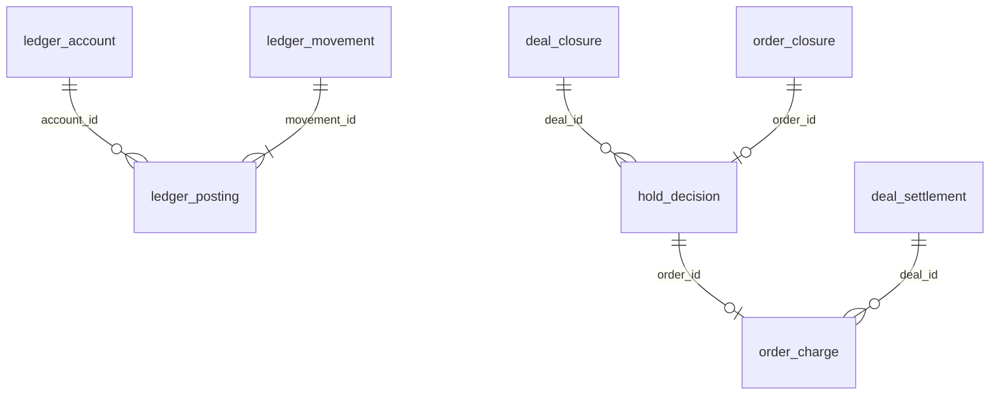

# Ledger schema

MySQL 8, written by Flyway from `src/main/resources/db/migration/`. The migrations are the truth; this page explains them. Times are UTC `DATETIME(6)` from the injected `Clock`. Money is `BIGINT` cents. IDs are UUIDs as `CHAR(36)`.

Summary of what each table is the source of truth for: [ARCHITECTURE.md §4](ARCHITECTURE.md#4-data). SQL checks: [HANDOVER.md §8](HANDOVER.md#8-runbooks).

| Migration | Adds |
|---|---|
| V1 `platform` | Starter tables: outbox, inbox, parking, timers, idempotency. Don't change |
| V2 `example_known_users` | `known_user` (starter example) |
| V3 `ledger` | `ledger_account`, `ledger_movement`, `ledger_posting`, the Union's two accounts |
| V4 `hold_decision` | `hold_decision` |
| V5 `closures` | `order_closure`, `deal_closure` |
| V6 `hold_state` | `hold_decision.state` |
| V7 `settlement` | `order_charge`, `deal_settlement` |

Only the two `ledger_posting` lines are foreign keys. The others are joins on the same business id.

## Money

### `ledger_account`

One row per account. Student and restaurant accounts are opened on first use. The Union's are inserted by V3.

| Column | Type | Notes |
|---|---|---|
| `id` | BIGINT PK, auto | Lock order between students is ascending `id` |
| `owner_type` | VARCHAR(20) | `STUDENT`, `RESTAURANT`, `UNION` |
| `owner_id` | CHAR(36) | Student or restaurant UUID; zero UUID for the Union |
| `purpose` | VARCHAR(20) | `AVAILABLE`, `HELD` (student), `PAYABLE` (restaurant), `CASH`, `COMMISSION` (Union) |
| `balance_cents` | BIGINT, default 0 | Signed. Kept up to date for **students only**; restaurant and Union rows stay 0, so they're never a hot row |
| `created_at` | DATETIME(6) | |

Unique: `(owner_type, owner_id, purpose)`.

### `ledger_movement`

One row per business effect. Its unique key is what makes a repeat move nothing.

| Column | Type | Notes |
|---|---|---|
| `id` | CHAR(36) PK | |
| `reference_type` | VARCHAR(40) | A `MovementType` (below) |
| `reference_id` | CHAR(36) | The business id: topUpId, orderId, ... |
| `posted_at` | DATETIME(6) | |

Unique: `(reference_type, reference_id)`.

### `ledger_posting`

The sides of a movement. Immutable. A movement's `amount_cents` add up to zero.

| Column | Type | Notes |
|---|---|---|
| `id` | BIGINT PK, auto | Statement order with `posted_at` |
| `movement_id` | CHAR(36) FK → `ledger_movement.id` | |
| `account_id` | BIGINT FK → `ledger_account.id` | |
| `amount_cents` | BIGINT | Signed, never 0 |
| `posted_at` | DATETIME(6) | |
| `entry_kind` | VARCHAR(30) NULL | `LedgerEntryKind`, only on the student's statement line (LED-11) |
| `description` | VARCHAR(200) NULL | Student-facing wording ("Set aside for your order") |
| `deal_id`, `order_id` | CHAR(36) NULL | Statement links |

Indexes: `(account_id, posted_at, id)` for the statement, `(movement_id)`.

### Movements posted today

All through `LedgerPostingService.post`. `+` increases the account's balance.

| `reference_type` | `reference_id` | Lines | Written by |
|---|---|---|---|
| `TOP_UP` | topUpId | student AVAILABLE `+a`, Union CASH `−a` | `TopUpStore` |
| `HOLD` | orderId | student AVAILABLE `−a`, student HELD `+a` | `Holds` |
| `RELEASE` | orderId | student HELD `−a`, student AVAILABLE `+a` | `Releases` |
| `ORDER_CHARGE` | orderId | student HELD `−hold`, restaurant PAYABLE `+(price − commission)`, Union COMMISSION `+commission`, student AVAILABLE `+(hold − price)` | `Settlement` |

`REFUND`, `WITHDRAWAL`, `WITHDRAWAL_PAYOUT`, `WITHDRAWAL_RETURN` and `PAYOUT` are reserved in `MovementType` and not posted yet. Lines with zero cents are left out.

## Holds and closures

### `hold_decision`

One row per order: the first answer to the hold call (LED-03, LED-04).

| Column | Type | Notes |
|---|---|---|
| `order_id` | CHAR(36) PK | Claimed first; a duplicate insert means a repeat, which reads this row back |
| `student_id`, `deal_id` | CHAR(36) | |
| `amount_cents` | BIGINT | What the order asked to set aside |
| `result` | VARCHAR(30) | `PLACED`, `INSUFFICIENT_FUNDS`, `DEAL_CLOSED`, `ORDER_CLOSED`. `PENDING` exists only inside the deciding transaction |
| `available_cents` | BIGINT NULL | Set only for `INSUFFICIENT_FUNDS` |
| `decided_at` | DATETIME(6) | |
| `state` | VARCHAR(20) NULL | V6. `OPEN` → exactly one of `RELEASED` or `CHARGED`; null for refusals |

Indexes: `(deal_id)`, `(deal_id, state)` for a deal's open holds. A release or charge wins with `UPDATE ... SET state = ? WHERE order_id = ? AND state = 'OPEN'`; one updated row means it won.

### `order_closure`, `deal_closure`

Orders and deals the Ledger has heard are closed. The first closing event writes the row; later ones change nothing. The hold call reads them `FOR SHARE`.

| Table | Key | Other columns | `reason` |
|---|---|---|---|
| `order_closure` | `order_id` | `deal_id`, `reason`, `closed_at` | `WITHDRAWN`, `ABANDONED` |
| `deal_closure` | `deal_id` | `reason`, `closed_at` | `CONFIRMED`, `FAILED`, `CANCELLED` |

## Settlement

### `order_charge`

What each charged order paid (LED-05). Refunds will check and update the running totals (LED-13, LED-14).

| Column | Type | Notes |
|---|---|---|
| `order_id` | CHAR(36) PK | |
| `deal_id`, `student_id`, `restaurant_id` | CHAR(36) | Index on `deal_id` |
| `price_cents` | BIGINT | |
| `commission_cents` | BIGINT | Rounded half up |
| `returned_cents` | BIGINT | `hold − price`, back to AVAILABLE |
| `refunded_cents`, `commission_reversed_cents` | BIGINT, default 0 | For refunds |
| `charged_at` | DATETIME(6) | |

### `deal_settlement`

One row per settled deal. Inserting it is the claim that makes a deal settle once (LED-06, decision 0007).

| Column | Type | Notes |
|---|---|---|
| `deal_id` | CHAR(36) PK | |
| `restaurant_id` | CHAR(36) | |
| `settled_at` | DATETIME(6) | |
| `charged_count`, `total_charged_cents`, `total_commission_cents` | INT, BIGINT, BIGINT | Filled in the same transaction |

## Starter tables (V1, V2)

| Table | Key | For |
|---|---|---|
| `outbox_event` | `id`; unique `event_id` | Events saved with the change, published in `id` order |
| `outbox_lease` | `name` | Which instance is the relay |
| `key_sequence` | `(topic, event_key)` | Per-key event sequence numbers |
| `processed_event` | `(consumer, event_id)` | `inbox.once`: each event handled once per consumer |
| `parked_event` | `id`; unique `(consumer, event_id)` | Events waiting for one they depend on |
| `timer` | `id`; unique `(timer_type, timer_key)` | Timers, claimed with `SKIP LOCKED` |
| `idempotency_record` | `(caller, idempotency_key)` | First answer per `Idempotency-Key` |
| `known_user` | `user_id` | Users heard on `users.v1` |

## Rules

- A movement's postings sum to zero; so do all postings.
- A student account's `balance_cents` equals the sum of its postings and is never negative. Restaurant PAYABLE and Union accounts may go negative (LED-13, LED-17).
- Lock order: business row (`hold_decision`, closure, `deal_settlement`), then student accounts by ascending `id`, then publish (decision 0004).
- Never edit an applied migration, not even a comment; add the next `V` number.
