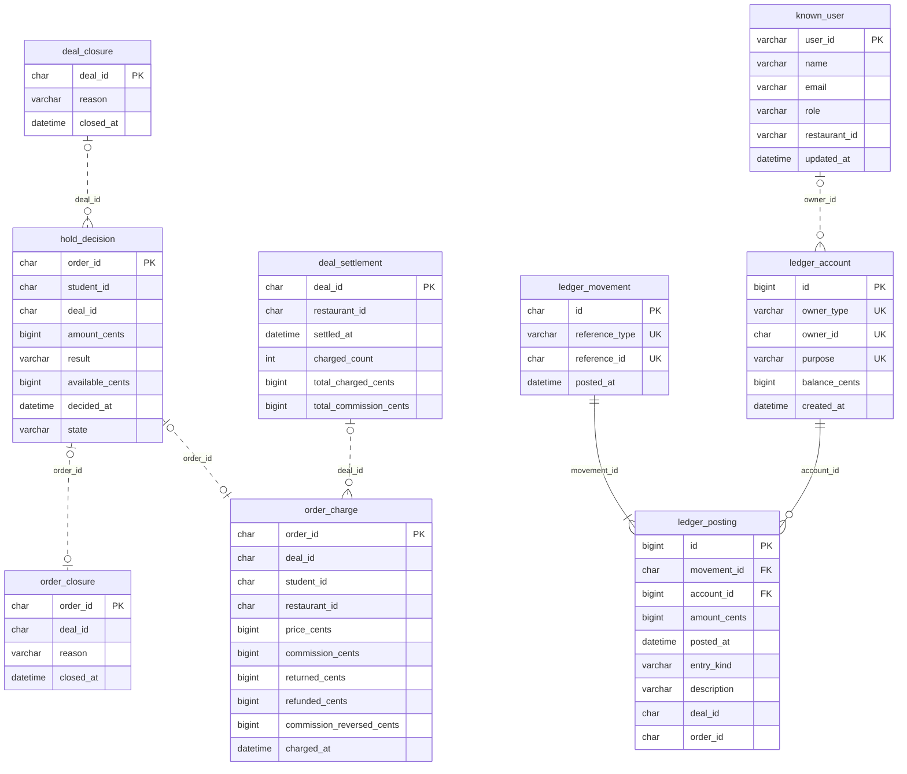
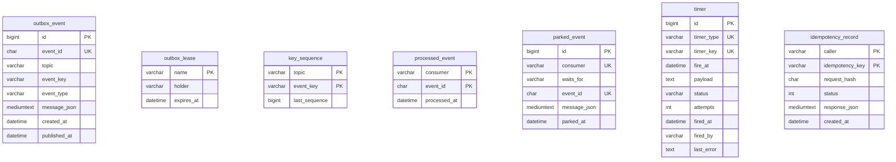

# Schema

MySQL 8, one database (`ledger`), built by Flyway from [db/migration](../src/main/resources/db/migration/). Sections 1 to 6 explain how the tables work together; the diagrams and the column reference follow. Words: [GLOSSARY.md](../GLOSSARY.md).

## 1 The model in one minute

Three groups of tables. Only the first holds money; the second remembers decisions so that repeats and races change nothing; the third is the starter's plumbing.

| Group | Tables | Is the truth for |
|---|---|---|
| **Money** | `ledger_account`, `ledger_movement`, `ledger_posting` | Every balance. A movement is one change of money; its postings are its sides and sum to 0 |
| **Decisions** | `hold_decision`, `order_closure`, `deal_closure`, `deal_settlement`, `order_charge` | What the Ledger already decided: each order's hold answer and state, which orders and deals are closed, which deals settled, what each order paid |
| **Plumbing** (starter, `platform/`) | `outbox_event`, `key_sequence`, `outbox_lease`, `processed_event`, `parked_event`, `timer`, `idempotency_record`, `known_user` | Events out (outbox), events in once (inbox), early events (parking), timers, HTTP idempotency, users seen |

There are only two foreign keys (posting → movement, posting → account). Every other link is a shared UUID: `order_id`, `deal_id`, `student_id`. IDs come from other services, so the Ledger never refuses a row because it hasn't seen the owner yet.

## 2 Signs and balances

`amount_cents` is signed, and the postings of one movement always sum to 0. Read the sign from the owner's side:

| Account (`owner_type`, `purpose`) | Positive means | Example, 14 Nov |
|---|---|---|
| STUDENT AVAILABLE | Money the student can spend. Never negative | +1,805 |
| STUDENT HELD | Money **set aside** for open orders, and (item 8, planned) cash-outs reserved at the desk. Students never see the word "held". Never negative | +1,600 |
| RESTAURANT PAYABLE | What the Union owes the restaurant | +10,350 (one restaurant's deals so far) |
| UNION COMMISSION | What the Union has earned | +3,170 |
| UNION CASH | Negative: the cash the desk took in, mirrored by everything above | −824,000 |

So `−(Union cash) = students' money + payables + commission`, and all postings sum to 0.

**`balance_cents` is kept for STUDENT rows only** (decision 0005). On UNION and RESTAURANT rows it is not maintained: on 14 Nov Union cash read −8000 there while its postings summed to −824,000. For those accounts always use `SUM(ledger_posting.amount_cents)`. The Union's two rows have the zero UUID as `owner_id` and exist from the first start (V3); every other account opens on first use.

## 3 Which key stops which double

| Must happen once | Enforced by | How a repeat ends |
|---|---|---|
| A money movement (top-up, hold, charge, release...) | `ledger_movement` UNIQUE (`reference_type`, `reference_id`) | The insert fails; `post` returns false and moves nothing |
| An account | `ledger_account` UNIQUE (`owner_type`, `owner_id`, `purpose`) | Upsert returns the existing id |
| One hold answer per order | `hold_decision` PK `order_id` | The insert fails; the saved answer is returned |
| A hold ends once | `UPDATE hold_decision SET state = … WHERE order_id = ? AND state = 'OPEN'` | 0 rows updated: the other side already won |
| A deal settles once | `deal_settlement` PK `deal_id`, inserted first | The insert fails; settlement stops before anything moves |
| An order is charged once | `order_charge` PK `order_id`, and the ORDER_CHARGE movement key | Both would fail |
| The first closure wins | `order_closure`, `deal_closure` PKs with `ON DUPLICATE KEY` no-op | Nothing changes |
| An event's effect, per consumer | `processed_event` PK (`consumer`, `event_id`) | `inbox.once` skips the effect |

`reference_type` is the movement's kind and `reference_id` its business key:

| `reference_type` | `reference_id` is | Postings |
|---|---|---|
| `TOP_UP` | topUpId | Student AVAILABLE +, Union CASH − |
| `HOLD` | orderId | Student AVAILABLE −, HELD + |
| `RELEASE` | orderId | Student HELD −, AVAILABLE + |
| `ORDER_CHARGE` | orderId | Student HELD −hold; Restaurant PAYABLE +(price − commission); Union COMMISSION +commission; Student AVAILABLE +rest (lines that would be 0 are left out) |
| `REFUND` | refundId | Student AVAILABLE +amount; Union COMMISSION −reversed; Restaurant PAYABLE −(amount − reversed). Built (LED-13) |
| `WITHDRAWAL` | withdrawalId | Student AVAILABLE −, HELD +. **Planned** (item 8) |
| `WITHDRAWAL_PAYOUT` | withdrawalId | Student HELD −, Union CASH +. **Planned** (item 8) |
| `WITHDRAWAL_RETURN` | withdrawalId | Student HELD −, AVAILABLE +. **Planned** (item 8) |
| `PAYOUT` | payoutId | Restaurant PAYABLE −, Union CASH +. **Planned** (item 8) |

## 4 What each operation writes

All in one transaction each; nothing is half-written.

| Operation | Trigger | Rows |
|---|---|---|
| Open accounts | UserRegistered, RestaurantRegistered, or first use | `ledger_account` ×2 (student) or ×1 (payable) |
| Top-up | TopUpRecorded | `processed_event`; `ledger_movement` TOP_UP + 2 `ledger_posting`; `outbox_event` TopUpCredited |
| Hold placed | `POST /internal/ledger/holds` | `hold_decision` (PLACED, state OPEN); `ledger_movement` HOLD + 2 postings; `outbox_event` HoldPlaced |
| Hold refused | same | `hold_decision` (ORDER_CLOSED, DEAL_CLOSED or INSUFFICIENT_FUNDS with `available_cents`; state NULL); `outbox_event` HoldRejected. No money moves |
| Order closed | OrderWithdrawn, OrderAbandoned | `processed_event`; `order_closure`; if the hold is open: state → RELEASED, RELEASE movement + 2 postings, HoldReleased |
| Deal failed or cancelled | DealFailed, DealCancelled | `processed_event`; `deal_closure`; each open hold released as above |
| Deal settled | DealConfirmed | `processed_event`; `deal_settlement` (claimed first, totals filled last); `deal_closure` CONFIRMED; per charged order: state → CHARGED, ORDER_CHARGE movement + 2 to 4 postings, `order_charge`, OrderCharged; per unlisted open hold: a release; per problem: SettlementIssue; one DealSettled |
| Refund | RefundApproved | `processed_event`; `order_charge` locked; `refund` (POSTED, EXCEEDS_CHARGE or NEVER_CHARGED); if posted: REFUND movement + 2 or 3 postings, `order_charge` refunded totals up, RefundPosted; otherwise RefundRefused. No charge yet: only `parked_event`, keyed `order:<id>` (hold open) or `deal:<id>` (no hold, deal undecided) |

Every event goes to `outbox_event` in the same transaction and is published from there; `key_sequence` numbers them per key: `studentId` for a student's events, `restaurantId` for DealSettled and PayoutDebited, `dealId` for SettlementIssue ([NEIGHBOURS §4](NEIGHBOURS.md#4-event-keys)).

### One order's life, real rows (14 Nov, golden path)

student031 joined deal `ea469992…` with 600 set aside; the deal confirmed at 500 with 10% commission.

| Movement | Account | `amount_cents` | Statement wording (`description`) |
|---|---|---|---|
| HOLD `470b6f15…` | STUDENT AVAILABLE | −600 | Set aside for your order |
| | STUDENT HELD | +600 | |
| ORDER_CHARGE `470b6f15…` | STUDENT HELD | −600 | |
| | RESTAURANT PAYABLE | +450 | |
| | UNION COMMISSION | +50 | |
| | STUDENT AVAILABLE | +100 | Paid €5.00, €1.00 back in your Account |

And the decision rows beside them: `hold_decision` (600, PLACED, state CHARGED); `order_charge` (500, 50, returned 100, refunded 0); `deal_settlement` (12 charged, 6000, 600); `deal_closure` CONFIRMED; `outbox_event` HoldPlaced and OrderCharged, both keyed by the student.

Statement fields (`entry_kind`, `description`, `deal_id`, `order_id`) are set only on the student's AVAILABLE side, the line the student sees.

## 5 Reading it

Shell: `docker exec -it devkit-mysql-1 sh -c 'mysql -uroot -p"$MYSQL_ROOT_PASSWORD" ledger'`. A student's balance and history, the books check and a deal's settlement: [HANDOVER §8](HANDOVER.md#8-runbooks). Three more:

Everything about one order:
```sql
SELECT h.result, h.state, h.amount_cents, c.price_cents, c.commission_cents, c.returned_cents, c.refunded_cents,
       (SELECT GROUP_CONCAT(reference_type ORDER BY posted_at) FROM ledger_movement WHERE reference_id = h.order_id) AS movements
FROM hold_decision h LEFT JOIN order_charge c ON c.order_id = h.order_id
WHERE h.order_id = '<orderId>';
```

A deal's holds by state (open ones still have money set aside):
```sql
SELECT result, state, COUNT(*), SUM(amount_cents) FROM hold_decision WHERE deal_id = '<dealId>' GROUP BY result, state;
```

Events not yet sent, and events taken in per consumer:
```sql
SELECT event_type, COUNT(*) FROM outbox_event WHERE published_at IS NULL GROUP BY event_type;
SELECT consumer, COUNT(*) FROM processed_event GROUP BY consumer;
```

## 6 Changing it

- A new table or column: a new migration with the next free `V` number when you merge. Never edit an applied one, not even a comment: Flyway's checksum stops the service.
- Already there for later items: `order_charge.refunded_cents` and `commission_reversed_cents` (refunds, item 6); the statement fields on `ledger_posting` (item 7).
- Still to add: the `withdrawal` table (section 7).
- `Migration checksum mismatch` on the dev kit: drop and create the `ledger` database (HANDOVER §9).

## 7 Fit with the contracts

Checked against contracts 1.3.0 on Sat 14 Nov: every shape another service sends us or reads from us, and the column it comes from.

| Contract shape | Stored in | Fits |
|---|---|---|
| HoldRequest: `orderId`, `studentId`, `dealId`, `cutoffAt`, `amountCents` ≥ 1 | `hold_decision` | Yes. `cutoffAt` is validated, not stored: the Ledger never refuses for time |
| HoldResponse: `availableCents` only for INSUFFICIENT_FUNDS | `hold_decision.available_cents` | Yes |
| Balance (`availableCents`, `heldCents` ≥ 0) on `/me`, `/students/{id}` and every student event | `ledger_account.balance_cents`, STUDENT rows, read under the lock | Yes: never negative. An unknown student reads zeros |
| LedgerEntry `kind`: TOP_UP, HOLD, RELEASE, RETURNED, REFUND, WITHDRAWAL, WITHDRAWAL_RETURNED | `ledger_posting.entry_kind`, on the AVAILABLE side | Yes: one kind per movement that changes available. A charge gives RETURNED only if something comes back; WITHDRAWAL_PAYOUT and PAYOUT never touch available, so no line |
| HoldReleased `reason`: WITHDRAWN, ABANDONED, DEAL_FAILED, DEAL_CANCELLED, NOT_ON_LIST | The closing event | Yes: NOT_ON_LIST is a release at settlement |
| DealCancelled `reason`: WITHDRAWN, DECLINED, NO_ANSWER | Not stored | `deal_closure.reason` says CANCELLED; nothing decides on why |
| OrderCharged, DealSettled | `order_charge`, `deal_settlement` | Yes |
| RefundPosted needs `restaurantId`, `commissionReversedCents` | `order_charge.restaurant_id`; the refund row | Yes (V9) |
| RefundRefused needs `dealId`, `studentId`, also for NEVER_CHARGED, when no `order_charge` row exists | RefundApproved's own fields | Yes: the refund row keeps them |
| WithdrawalRefused `reason`: INSUFFICIENT_FUNDS only; Payments shows RESERVED or REFUSED | The withdrawal row | Planned: REFUSED is kept, so a repeat gets the same answer |
| WithdrawalCompleted, WithdrawalFailed: `amountCents` ≥ 0 | `withdrawal.amount_cents`, from WithdrawalRequested | Planned: the reserved amount wins (item 8) |
| PayoutConfirmed: `payoutId`, `restaurantId`, `amountCents` ≥ 1 | The PAYOUT movement, keyed by `payoutId` | Planned: no table, the movement key makes it once. A payable may go negative after a refund |
| DealConfirmed `orders`: no maximum | | The 200 orders in `SettlementTest` is the load test's deal (PLT-14), not a contract limit |

**Planned tables** (the owning item takes the next free `V` number when it merges):

| Table | Columns | Why these |
|---|---|---|
| `withdrawal` (item 8) | `withdrawal_id` PK, `student_id`, `amount_cents`, `state` (RESERVED, REFUSED, PAID_OUT, RETURNED), `decided_at` | Paid out or returned is `UPDATE ... WHERE state = 'RESERVED'`, like a hold (decision 0008) |

**Open, for the owning item:**
- Decided (item 6): when RefundApproved's `studentId` differs from the charged order's, the money goes to the student `order_charge` says paid; the refund row keeps what Support sent.
- WithdrawalCompleted or WithdrawalFailed for a refused or unknown cash-out: nothing moves; which event, if any? (item 8).

## Diagrams

Solid line: foreign key. <br>
Dotted line: shared ID, no foreign key

### Ledger Tables


### Platform Tables


## Ledger tables

### `ledger_account` (V3)

One account per owner and purpose.

| Field | Type | Attributes |
|---|---|---|
| `id` | BIGINT | PK, auto increment |
| `owner_type` | VARCHAR(20) | Unique (`owner_type`, `owner_id`, `purpose`); STUDENT, RESTAURANT, UNION |
| `owner_id` | CHAR(36) | Unique (`owner_type`, `owner_id`, `purpose`) |
| `purpose` | VARCHAR(20) | Unique (`owner_type`, `owner_id`, `purpose`); AVAILABLE, HELD, PAYABLE, CASH, COMMISSION |
| `balance_cents` | BIGINT | Default 0. Kept for STUDENT rows only; on UNION and RESTAURANT rows it is stale: use the sum of postings (section 2) |
| `created_at` | DATETIME(6) | |

### `ledger_movement` (V3)

One business movement.

| Field | Type | Attributes |
|---|---|---|
| `id` | CHAR(36) | PK |
| `reference_type` | VARCHAR(40) | Unique (`reference_type`, `reference_id`) |
| `reference_id` | CHAR(36) | Unique (`reference_type`, `reference_id`) |
| `posted_at` | DATETIME(6) | |

### `ledger_posting` (V3)

One immutable side of a movement; a movement's postings sum to zero.

| Field | Type | Attributes |
|---|---|---|
| `id` | BIGINT | PK, auto increment |
| `movement_id` | CHAR(36) | FK → `ledger_movement.id`; index |
| `account_id` | BIGINT | FK → `ledger_account.id`; index (`account_id`, `posted_at`, `id`) |
| `amount_cents` | BIGINT | Signed |
| `posted_at` | DATETIME(6) | |
| `entry_kind` | VARCHAR(30) | Nullable |
| `description` | VARCHAR(200) | Nullable |
| `deal_id` | CHAR(36) | Nullable |
| `order_id` | CHAR(36) | Nullable |

### `hold_decision` (V4, V6)

First hold answer per order, and the hold's state.

| Field | Type | Attributes |
|---|---|---|
| `order_id` | CHAR(36) | PK |
| `student_id` | CHAR(36) | |
| `deal_id` | CHAR(36) | Index; index (`deal_id`, `state`) |
| `amount_cents` | BIGINT | |
| `result` | VARCHAR(30) | PLACED, INSUFFICIENT_FUNDS, DEAL_CLOSED, ORDER_CLOSED |
| `available_cents` | BIGINT | Nullable |
| `decided_at` | DATETIME(6) | |
| `state` | VARCHAR(20) | Nullable; OPEN, RELEASED, CHARGED; index (`deal_id`, `state`) |

### `order_closure` (V5)

Orders the Ledger has seen closed.

| Field | Type | Attributes |
|---|---|---|
| `order_id` | CHAR(36) | PK |
| `deal_id` | CHAR(36) | |
| `reason` | VARCHAR(30) | WITHDRAWN, ABANDONED (the V5 comment lists all five; the code writes these two) |
| `closed_at` | DATETIME(6) | |

### `deal_closure` (V5)

Deals the Ledger has seen closed.

| Field | Type | Attributes |
|---|---|---|
| `deal_id` | CHAR(36) | PK |
| `reason` | VARCHAR(30) | CONFIRMED, FAILED, CANCELLED |
| `closed_at` | DATETIME(6) | |

### `order_charge` (V7)

What a charged order paid, with refund totals.

| Field | Type | Attributes |
|---|---|---|
| `order_id` | CHAR(36) | PK |
| `deal_id` | CHAR(36) | Index |
| `student_id` | CHAR(36) | |
| `restaurant_id` | CHAR(36) | |
| `price_cents` | BIGINT | |
| `commission_cents` | BIGINT | |
| `returned_cents` | BIGINT | |
| `refunded_cents` | BIGINT | Default 0 |
| `commission_reversed_cents` | BIGINT | Default 0 |
| `charged_at` | DATETIME(6) | |

### `deal_settlement` (V7)

One row per settled deal.

| Field | Type | Attributes |
|---|---|---|
| `deal_id` | CHAR(36) | PK |
| `restaurant_id` | CHAR(36) | |
| `settled_at` | DATETIME(6) | |
| `charged_count` | INT | Default 0 |
| `total_charged_cents` | BIGINT | Default 0 |
| `total_commission_cents` | BIGINT | Default 0 |

### `refund` (V9)

One row per decided refund. A refund waiting for its charge has no row: it is parked.

| Field | Type | Attributes |
|---|---|---|
| `refund_id` | CHAR(36) | PK: a repeated RefundApproved finds it and changes nothing |
| `order_id` | CHAR(36) | Index |
| `deal_id` | CHAR(36) | From RefundApproved |
| `student_id` | CHAR(36) | From RefundApproved; the money goes to `order_charge.student_id` |
| `amount_cents` | BIGINT | |
| `commission_reversed_cents` | BIGINT | Default 0 |
| `reason` | VARCHAR(30) | COMPLAINT, KITCHEN_FAILURE (Support's) |
| `outcome` | VARCHAR(30) | POSTED, EXCEEDS_CHARGE, NEVER_CHARGED |
| `decided_at` | DATETIME(6) | |

### `known_user` (V2)

Users from users.v1.

| Field | Type | Attributes |
|---|---|---|
| `user_id` | VARCHAR(36) | PK |
| `name` | VARCHAR(200) | |
| `email` | VARCHAR(200) | |
| `role` | VARCHAR(30) | |
| `restaurant_id` | VARCHAR(36) | Nullable |
| `updated_at` | DATETIME(6) | |

## Platform tables (V1)

### `outbox_event`
| Field | Type | Attributes |
|---|---|---|
| `id` | BIGINT | PK, auto increment; index (`published_at`, `id`) |
| `event_id` | CHAR(36) | Unique |
| `topic` | VARCHAR(100) | |
| `event_key` | VARCHAR(100) | |
| `event_type` | VARCHAR(100) | |
| `message_json` | MEDIUMTEXT | |
| `created_at` | DATETIME(6) | |
| `published_at` | DATETIME(6) | Nullable; index (`published_at`, `id`) |

### `outbox_lease`
| Field | Type | Attributes |
|---|---|---|
| `name` | VARCHAR(50) | PK |
| `holder` | VARCHAR(200) | |
| `expires_at` | DATETIME(6) | |

### `key_sequence`
| Field | Type | Attributes |
|---|---|---|
| `topic` | VARCHAR(100) | PK (`topic`, `event_key`) |
| `event_key` | VARCHAR(100) | PK (`topic`, `event_key`) |
| `last_sequence` | BIGINT | |

### `processed_event`
| Field | Type | Attributes |
|---|---|---|
| `consumer` | VARCHAR(100) | PK (`consumer`, `event_id`) |
| `event_id` | CHAR(36) | PK (`consumer`, `event_id`) |
| `processed_at` | DATETIME(6) | |

### `parked_event`
| Field | Type | Attributes |
|---|---|---|
| `id` | BIGINT | PK, auto increment |
| `consumer` | VARCHAR(100) | Unique (`consumer`, `event_id`); index (`consumer`, `waits_for`) |
| `waits_for` | VARCHAR(200) | Index (`consumer`, `waits_for`) |
| `event_id` | CHAR(36) | Unique (`consumer`, `event_id`) |
| `message_json` | MEDIUMTEXT | |
| `parked_at` | DATETIME(6) | |

### `timer`
| Field | Type | Attributes |
|---|---|---|
| `id` | BIGINT | PK, auto increment |
| `timer_type` | VARCHAR(100) | Unique (`timer_type`, `timer_key`) |
| `timer_key` | VARCHAR(200) | Unique (`timer_type`, `timer_key`) |
| `fire_at` | DATETIME(6) | Index (`status`, `fire_at`) |
| `payload` | TEXT | Nullable |
| `status` | VARCHAR(20) | Default PENDING; index (`status`, `fire_at`) |
| `attempts` | INT | Default 0 |
| `fired_at` | DATETIME(6) | Nullable |
| `fired_by` | VARCHAR(200) | Nullable |
| `last_error` | TEXT | Nullable |

### `idempotency_record`
| Field | Type | Attributes |
|---|---|---|
| `caller` | VARCHAR(100) | PK (`caller`, `idempotency_key`) |
| `idempotency_key` | VARCHAR(100) | PK (`caller`, `idempotency_key`) |
| `request_hash` | CHAR(64) | |
| `status` | INT | |
| `response_json` | MEDIUMTEXT | Nullable |
| `created_at` | DATETIME(6) | |
