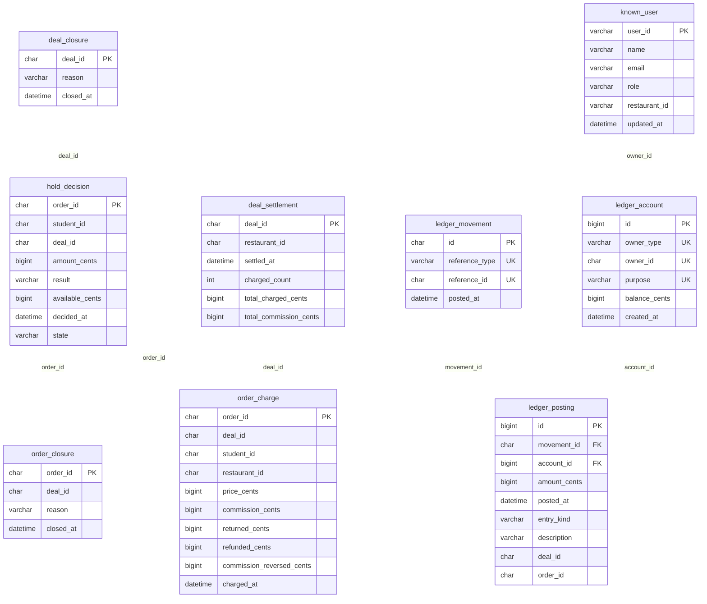
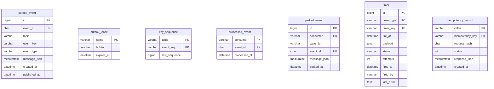

# Schema
MySQL, migrations are in ([db/migration](../src/main/resources/db/migration/)).

## Diagrams

Solid line: foreign key.  
Dotted line: shared ID, no foreign key

### Ledger Tables

### Platform Tables

## Ledger tables

### `ledger_account` (V3)

One account per owner and purpose.

| Field | Type | Attributes |
|---|---|---|
| `id` | BIGINT | PK, auto increment |
| `owner_type` | VARCHAR(20) | Unique (`owner_type`, `owner_id`, `purpose`); STUDENT, RESTAURANT, UNION |
| `owner_id` | CHAR(36) | Unique (`owner_type`, `owner_id`, `purpose`) |
| `purpose` | VARCHAR(20) | Unique (`owner_type`, `owner_id`, `purpose`); AVAILABLE, HELD, PAYABLE, CASH, COMMISSION |
| `balance_cents` | BIGINT | Default 0 |
| `created_at` | DATETIME(6) | |

### `ledger_movement` (V3)

One business movement.

| Field | Type | Attributes |
|---|---|---|
| `id` | CHAR(36) | PK |
| `reference_type` | VARCHAR(40) | Unique (`reference_type`, `reference_id`) |
| `reference_id` | CHAR(36) | Unique (`reference_type`, `reference_id`) |
| `posted_at` | DATETIME(6) | |

### `ledger_posting` (V3)

One immutable side of a movement; a movement's postings sum to zero.

| Field | Type | Attributes |
|---|---|---|
| `id` | BIGINT | PK, auto increment |
| `movement_id` | CHAR(36) | FK → `ledger_movement.id`; index |
| `account_id` | BIGINT | FK → `ledger_account.id`; index (`account_id`, `posted_at`, `id`) |
| `amount_cents` | BIGINT | Signed |
| `posted_at` | DATETIME(6) | |
| `entry_kind` | VARCHAR(30) | Nullable |
| `description` | VARCHAR(200) | Nullable |
| `deal_id` | CHAR(36) | Nullable |
| `order_id` | CHAR(36) | Nullable |

### `hold_decision` (V4, V6)

First hold answer per order, and the hold's state.

| Field | Type | Attributes |
|---|---|---|
| `order_id` | CHAR(36) | PK |
| `student_id` | CHAR(36) | |
| `deal_id` | CHAR(36) | Index; index (`deal_id`, `state`) |
| `amount_cents` | BIGINT | |
| `result` | VARCHAR(30) | PLACED, INSUFFICIENT_FUNDS, DEAL_CLOSED, ORDER_CLOSED |
| `available_cents` | BIGINT | Nullable |
| `decided_at` | DATETIME(6) | |
| `state` | VARCHAR(20) | Nullable; OPEN, RELEASED, CHARGED; index (`deal_id`, `state`) |

### `order_closure` (V5)

Orders the Ledger has seen closed.

| Field | Type | Attributes |
|---|---|---|
| `order_id` | CHAR(36) | PK |
| `deal_id` | CHAR(36) | |
| `reason` | VARCHAR(30) | WITHDRAWN, ABANDONED, CONFIRMED, FAILED, CANCELLED |
| `closed_at` | DATETIME(6) | |

### `deal_closure` (V5)

Deals the Ledger has seen closed.

| Field | Type | Attributes |
|---|---|---|
| `deal_id` | CHAR(36) | PK |
| `reason` | VARCHAR(30) | WITHDRAWN, ABANDONED, CONFIRMED, FAILED, CANCELLED |
| `closed_at` | DATETIME(6) | |

### `order_charge` (V7)

What a charged order paid, with refund totals.

| Field | Type | Attributes |
|---|---|---|
| `order_id` | CHAR(36) | PK |
| `deal_id` | CHAR(36) | Index |
| `student_id` | CHAR(36) | |
| `restaurant_id` | CHAR(36) | |
| `price_cents` | BIGINT | |
| `commission_cents` | BIGINT | |
| `returned_cents` | BIGINT | |
| `refunded_cents` | BIGINT | Default 0 |
| `commission_reversed_cents` | BIGINT | Default 0 |
| `charged_at` | DATETIME(6) | |

### `deal_settlement` (V7)

One row per settled deal.

| Field | Type | Attributes |
|---|---|---|
| `deal_id` | CHAR(36) | PK |
| `restaurant_id` | CHAR(36) | |
| `settled_at` | DATETIME(6) | |
| `charged_count` | INT | Default 0 |
| `total_charged_cents` | BIGINT | Default 0 |
| `total_commission_cents` | BIGINT | Default 0 |

### `known_user` (V2)

Users from users.v1.

| Field | Type | Attributes |
|---|---|---|
| `user_id` | VARCHAR(36) | PK |
| `name` | VARCHAR(200) | |
| `email` | VARCHAR(200) | |
| `role` | VARCHAR(30) | |
| `restaurant_id` | VARCHAR(36) | Nullable |
| `updated_at` | DATETIME(6) | |

## Platform tables (V1)

### `outbox_event`
| Field | Type | Attributes |
|---|---|---|
| `id` | BIGINT | PK, auto increment; index (`published_at`, `id`) |
| `event_id` | CHAR(36) | Unique |
| `topic` | VARCHAR(100) | |
| `event_key` | VARCHAR(100) | |
| `event_type` | VARCHAR(100) | |
| `message_json` | MEDIUMTEXT | |
| `created_at` | DATETIME(6) | |
| `published_at` | DATETIME(6) | Nullable; index (`published_at`, `id`) |

### `outbox_lease`
| Field | Type | Attributes |
|---|---|---|
| `name` | VARCHAR(50) | PK |
| `holder` | VARCHAR(200) | |
| `expires_at` | DATETIME(6) | |

### `key_sequence`
| Field | Type | Attributes |
|---|---|---|
| `topic` | VARCHAR(100) | PK (`topic`, `event_key`) |
| `event_key` | VARCHAR(100) | PK (`topic`, `event_key`) |
| `last_sequence` | BIGINT | |

### `processed_event`
| Field | Type | Attributes |
|---|---|---|
| `consumer` | VARCHAR(100) | PK (`consumer`, `event_id`) |
| `event_id` | CHAR(36) | PK (`consumer`, `event_id`) |
| `processed_at` | DATETIME(6) | |

### `parked_event`
| Field | Type | Attributes |
|---|---|---|
| `id` | BIGINT | PK, auto increment |
| `consumer` | VARCHAR(100) | Unique (`consumer`, `event_id`); index (`consumer`, `waits_for`) |
| `waits_for` | VARCHAR(200) | Index (`consumer`, `waits_for`) |
| `event_id` | CHAR(36) | Unique (`consumer`, `event_id`) |
| `message_json` | MEDIUMTEXT | |
| `parked_at` | DATETIME(6) | |

### `timer`
| Field | Type | Attributes |
|---|---|---|
| `id` | BIGINT | PK, auto increment |
| `timer_type` | VARCHAR(100) | Unique (`timer_type`, `timer_key`) |
| `timer_key` | VARCHAR(200) | Unique (`timer_type`, `timer_key`) |
| `fire_at` | DATETIME(6) | Index (`status`, `fire_at`) |
| `payload` | TEXT | Nullable |
| `status` | VARCHAR(20) | Default PENDING; index (`status`, `fire_at`) |
| `attempts` | INT | Default 0 |
| `fired_at` | DATETIME(6) | Nullable |
| `fired_by` | VARCHAR(200) | Nullable |
| `last_error` | TEXT | Nullable |

### `idempotency_record`
| Field | Type | Attributes |
|---|---|---|
| `caller` | VARCHAR(100) | PK (`caller`, `idempotency_key`) |
| `idempotency_key` | VARCHAR(100) | PK (`caller`, `idempotency_key`) |
| `request_hash` | CHAR(64) | |
| `status` | INT | |
| `response_json` | MEDIUMTEXT | Nullable |
| `created_at` | DATETIME(6) | |
