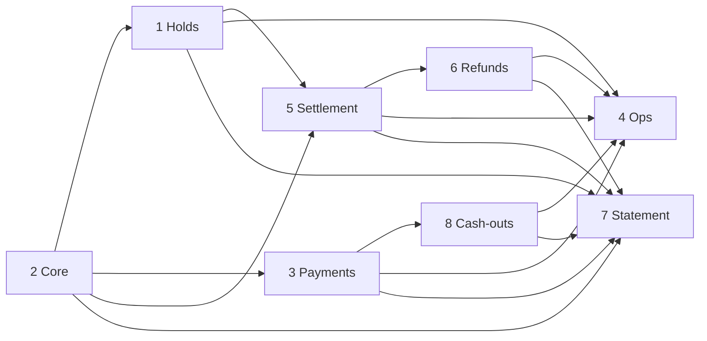

# Work items

One area per person (decision [0001](../docs/decisions/0001-work-split.md)). Every LED story has one owner.

| Item | Area | Owner · Backup | LED |
|---|---|---|---|
| [1](item1_hersh.md) | Holds, integration | Hersh · Igor | 01, 03, 04, 18 (sign-in down), 22 (holds), 24 (SQL) |
| [2](item2_igor.md) | Core and data | Igor · Member 7 | 07, 20 (posting), 24 (migrations) |
| [3](item3_sam.md) | Payments events, contracts | Sam · Member 6 | 02, 19 |
| [4](item4_shakeeba.md) | Operations | Shakeeba · Sam | 21, 22 (k6), 23, 24 (handover) |
| [5](item5_settlement.md) | Settlement, releases | Hersh · Member 5 | 05, 06, 08, 09, 10 |
| [6](item6_refunds.md) | Refunds | Member 6 · Member 5 | 13, 14 |
| [7](item7_statement.md) | Statement, desk, testing | Member 7 · Shakeeba | 11, 12, 18 (pages), 20 (property test) |
| [8](item8_cashouts.md) | Cash-outs, payouts | Member 5 · Sam | 15, 16, 17 |

## Dependencies



## Shared interfaces

Code against these from day one; a stub comes first. Change one only with both sides.

```kotlin
// Item 6 implements; item 5 calls them in its transaction.
interface RefundWakeups { fun orderCharged(orderId: UUID); fun holdReleased(orderId: UUID); fun dealDecided(dealId: UUID) }
// Item 2 provides.
fun lockStudents(studentIds: Collection<UUID>): MutableMap<UUID, Balance>   // one query, ascending id
fun openRestaurant(restaurantId: UUID)
```

## Timeline

| By | What |
|---|---|
| Sat 11:00 | Design review: these docs on `main`, tag `checkpoint-1` |
| Sat 15:50 | Proof of concept, tag `checkpoint-2` |
| Sat 16:30 | Hold call and top-ups promoted into integration |
| Sat 21:00 | Settlement on the golden path |
| Sun 14:00 | Golden path on all real services |
| Sun 16:00 | Freeze, tag `release` |

If short of time: drop payouts, then cash-out returns, before refunds.

## Working in parallel

- **Branches:** `item-<n>/<topic>`; PR into `main`, reviewed by the area's backup, prompts included (handover §18.4).
- **Migrations:** take the next free `V` number when you merge (Flyway rejects one lower than the database has). Never edit an applied one.
- **Files:** each area edits its own; others' only through a shared interface.

| Files | Item |
|---|---|
| `Holds.kt`, `Closures.kt`, `SignInUnavailable.kt`, V4–V6 | 1 |
| `LedgerAccounts.kt`, `LedgerPostings.kt`, `LedgerController.kt`, `TopUpStore.kt`, V3 | 2 |
| `PaymentsConsumer.kt`, `TopUpPosting.kt`, `ContractTest.kt` | 3 |
| compose, CI, `grafana/`, `scripts/k6/`, `docs/HANDOVER.md`, `docs/evidence/` | 4 |
| `Releases.kt`, `Settlement.kt`, `RefundWakeups.kt` (until item 6), V7 | 5 |
| `Refunds.kt`, `SupportConsumer.kt` | 6 |
| `StatementController.kt`, `DeskController.kt`, `ZeroSumPropertyTest.kt` | 7 |
| `Withdrawals.kt`, `Payouts.kt` | 8 |

**Rules for every change:**
- Money moves only through `post`.
- Balances come from `lockStudent(s)`.
- Lock order: business rows, then students, then publish.
- Every effect has a business key.
- One listener per topic.
- Time only from `Clock`.
